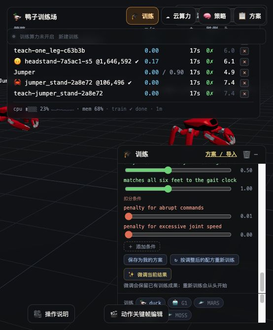

# “跳跳”（Jumper）接入与验证

“跳跳”（Jumper，KingKong Robotics）已经接入本地实验室和根目录的 `microduck_rl`。这是仿真训练原型；当前提供站立与三足步态配方，没有经过收敛验收的行走/跳跃策略，也没有实机验证。

## 资源

来源：[KingKongRobotics/jumper](https://github.com/KingKongRobotics/jumper)，固定版本 `61d065219fca767f3142c8f10aff59eae5a5a004`，Apache-2.0。80 个被引用的模型、网格、电机配置及许可证文件逐个做 SHA-256 校验，约 22 MB，存入各工程的 `.cache/jumper`，不提交二进制资源。XML 的碰撞与 PD 配置在内存中适配，不改上游原件。

```bash
cd microduck_local
uv run fetch-robot jumper
uv run duck-lab
```

实验室的机器人面板选择 **🦀 Jumper**，可添加机器人、查看真实 MuJoCo 姿态与奖励；教学面板选择站立或三足步态，再选择本机训练。训练、快照、暂停、继续及 ONNX 导出复用现有流水线。教学卡片的奖励项由环境计算，属于固定配方。

如果已有离线的上游 checkout，可以运行：

```bash
PYTHONPATH=src .venv/bin/python -c 'from pathlib import Path; from microduck_local.robots.jumper_model import fetch; fetch(Path("/path/to/jumper"))'
```

两个工程也可通过 `MICRODUCK_JUMPER_DIR` 指向同一份已校验缓存。

## 契约

| 项目 | 本次适配 |
|---|---|
| 物理关节 | 22；两个夹爪固定在 HOME |
| 策略动作 | 20，按资产清单中的关节顺序；HOME + 0.25 × clip(action, -4, 4) |
| 观测 | 71，`jumper-lab-71-v1` |
| 时序 | 物理 1 ms，策略 20 ms（50 Hz） |
| 执行器 | 位置 PD：kp=10，kd=0.5，力矩上限 1.7464 Nm |
| 三足分组 | LF/RM/LR 与 RF/LM/RR；3.125 Hz，静止时关闭步态时钟 |

观测顺序：角速度 `[0:3]`、投影重力 `[3:6]`、关节相对位置 `[6:26]`、关节速度 `[26:46]`、上次动作 `[46:66]`、速度指令 `[66:69]`、步态时钟 `[69:71]`。

本地 SB3 导出和 mjlab 导出都把观测归一化烘焙进 ONNX，并写入相同的契约元数据。**官方 Jumper 策略使用历史观测和不同电机模型，不能直接加载。** 此处恒定力矩限幅没有上游的转速/温度限制；MicroDuck 的 BAM 参数也不适用于 Jumper。

`/sim` 的房间挂载目前只提供 HOME 站立控制器，尚未接入房间行走策略。实验室训练/推理使用独立的六足环境，能够载入本次契约的导出策略。跳跃、波纹步态、四足步态和手势尚未移植。

## mjlab 训练端

训练适配发布在 [heranhe/microduck_rl 的 jumper-integration 分支](https://github.com/heranhe/microduck_rl/tree/jumper-integration)。本地在工作区根目录的 `microduck_rl` 中运行（不是 `microduck-lab/microduck_rl` 上游副本）：

```bash
git clone --branch jumper-integration https://github.com/heranhe/microduck_rl.git
cd microduck_rl
uv sync
```

```bash
uv run scripts/fetch_jumper.py
uv run train Mjlab-Stand-Flat-Jumper --env.scene.num-envs 1024
uv run train Mjlab-Tripod-Flat-Jumper --env.scene.num-envs 1024
uv run scripts/export.py Mjlab-Tripod-Flat-Jumper --checkpoint-file logs/rsl_rl/jumper_tripod/<run>/model_1000.pt --onnx-file jumper.onnx
```

使用现有 mjlab 1.3 与 rsl_rl，不升级依赖。GPU 训练需在可用 CUDA 机器执行；Mac 已验证 Warp CPU 环境步进。CPU 与 mjlab 的奖励配方实现各自独立，但策略布局和动作含义一致；相同形状不等于已完成跨引擎策略效果验收。

## 检查

```bash
# microduck_local
uv run --with pytest pytest tests/test_jumper.py tests/test_body_conformance.py tests/test_policy_contract.py -q
# 根目录 microduck_rl
uv run --with pytest pytest tests/test_jumper_cfg.py -q
```

检查涵盖缓存损坏拒绝与修复、22/20 关节映射、六足接触、站立稳定性、观测顺序、步态相位、PPO 参数更新以及带归一化的 ONNX 数值一致性。没有资源时，依赖网格的测试会明确跳过。

## 本次实施验证记录

- 实验室全量检查：首次 1918 通过、535 跳过、8 失败；修正 Jumper 导出测试参数，并在允许本地套接字/多进程的环境中重跑失败项，8 项全部通过。合计 1926 项通过；跳过项主要依赖未下载的其他机器人资源。
- 最终机器人注册、契约、导出与 Jumper 检查：139 通过、51 跳过。
- 根目录训练工作区：164 通过、1 跳过；排除无关本地改动后的 GitHub 发布快照单独验证：159 通过、1 跳过；前端生产构建通过。
- 真实 mjlab Warp CPU 环境：actor/critic 均为 `[1, 71]`，20 个动作，完成 10 步且没有终止或 NaN。
- 经实验室 `/teach` 启动站立流程验证：`teach-jumper_stand-2a8e72`，32 个并行环境，实际 106496 步（预算 100000，按完整 rollout 收尾），约 44 秒，3 个快照；最终模型、归一化统计和 ONNX 已保存在本地 runs/，前端已加载最终策略。此记录只证明训练/导出/加载流程可用，不代表完成步态收敛验收。


