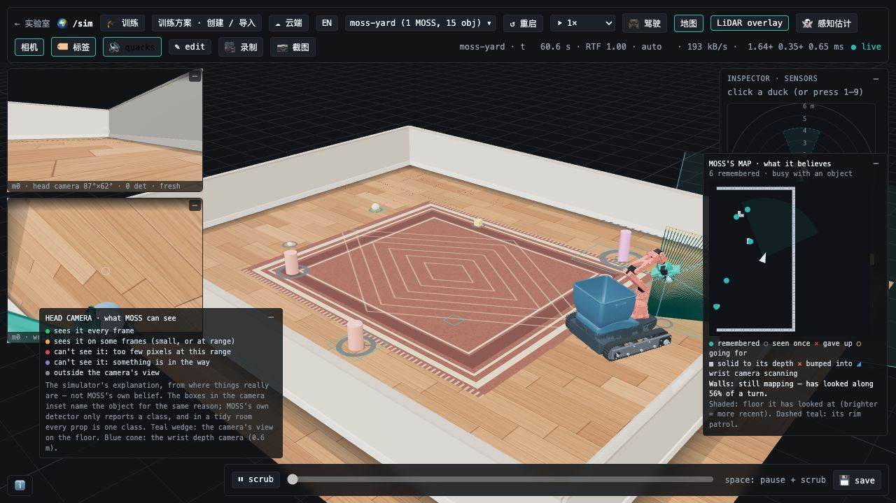

# 2026-10-05 上游同步记录

## 合并范围

从本分支 `8803c09` 同步 Jonathan Hawkins 项目的 `bbf0326`（MOSS 第四种机器人）。先记录此前已导入的 MARS 基线 `47c62e3` 的祖先关系，再执行正常合并，避免把旧的复制提交误判为新增冲突。上游新增的 MOSS 世界、任务、腕相机、感知解释、地图和多任务训练进入同一代码树。

## 保留与兼容

1. 保留训练方案的模板、JSON/Python 导入、参考动作、版本、导出、运行记录和 AI 草稿。
2. 保留 Google Colab / Hugging Face 云端工作流、中英文界面、本地保存停止与从检查点续训。
3. 多任务以运行名称和实际学员 ID 路由；选中的任务决定监看、停止、续训、权重编辑和清卡目标。助手按其策略所属运行及课程链归属，不跟随其他任务的快照或阶段切换。
4. 保存中的任务继续保留环境预算与预览；云端启动检查所有本地活跃任务。加载历史运行不转移其他卡片的预览所有权。
5. 补齐 MOSS 碰撞包：机器人基础资源继续固定 `be395a8076b156d1983dbf847601cd63b836b19c`，独立碰撞包固定 `39c6de8fa26a7c7f0ebd332e126c620550087a7d`。全部 130 个文件逐个验证 SHA-256；派生模型仍在本地生成，不提交缓存。
6. 腕相机覆盖原始资产和碰撞模型两条构建路径，并且重复调用不会生成同名 body。
7. 终止信息先完成共享数据和同步通知，再写入进程管道，防止大体积信息填满管道后互相等待；覆盖单环境和打包环境。

## 验证

- 前端：388 项测试通过，ESLint 和生产构建（含 TypeScript）通过。
- MOSS：135 项测试通过、4 项按条件跳过；真实资产校验、碰撞、相机、驱动、整理和地图测试均运行。
- 多任务与训练进程：174 项测试通过；最后的助手计数修复后，实验室单独回归 145 项通过。
- 浏览器：MOSS yard 实际渲染，头部相机、腕部相机、LiDAR 和地图有实时数据；截图时 RTF 1.00，控制台没有 error。训练方案页面展示 MOSS 模板，原有本地和云端入口保留。
- 真实并行训练：隔离数据目录同时启动 `one_leg`（32 env）和 `spin`（14 env），两者均完成并生成独立策略；环境预算结束后归零。小预算只用于验证流程，不代表学会动作。
- 真实保存续训：`spin` 在 8,224 步保存并停止，从同一运行目录恢复至 100,000 步并导出 ONNX 模型。
- 最终全量后端：2,043 项通过、381 项按条件跳过，0 失败（893.93 秒）。静态检查、暂存区 Python 语法检查与关键模块导入全部通过。

云端服务的协议、资源释放和冲突检查通过自动化测试；本次未租用云端 GPU 运行训练。条件跳过的测试以 pytest 输出为准，不计作通过。

## 升级

1. 已有训练先完成或保存停止，再更新 `main` 并重启服务。
2. 在 `microduck_local` 执行 `uv sync --locked`；在 `duck-viewer` 执行 `npm ci` 和 `npm run build`。
3. 首次使用或已经下载过 MOSS，都执行 `uv run fetch-robot moss` 补齐当前资源。
4. 按 README 重启后端与前端。原有训练目录、模型和训练方案无需迁移。

## 回退与后续同步

更新前的源码保留在 `backup/before-upstream-2026-10-05`，本地未跟踪文件另有备份。训练数据与依赖模型未被覆盖。

需要回退时可在单独 worktree 检出该备份分支，并按旧版依赖启动；共享主分支不要强制重置或强制推送。未来更新在隔离分支执行 `git fetch upstream` 和 `git merge upstream/main`，完成自有功能回归后再进入 `main`。
